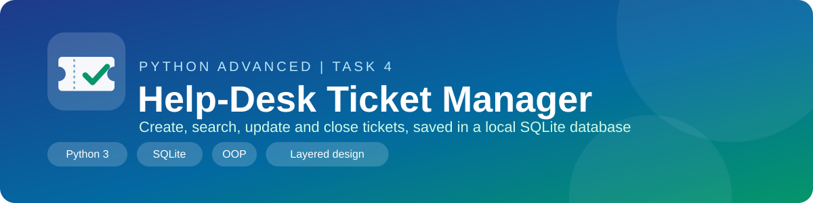
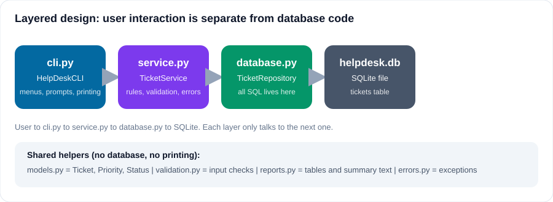
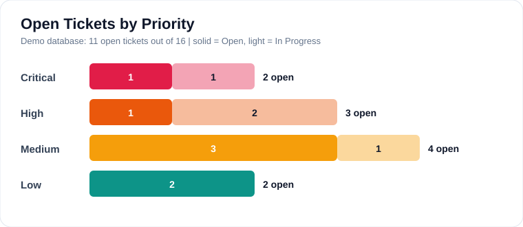
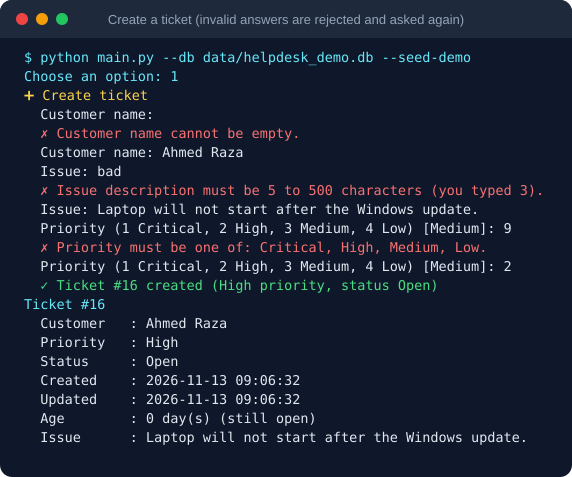
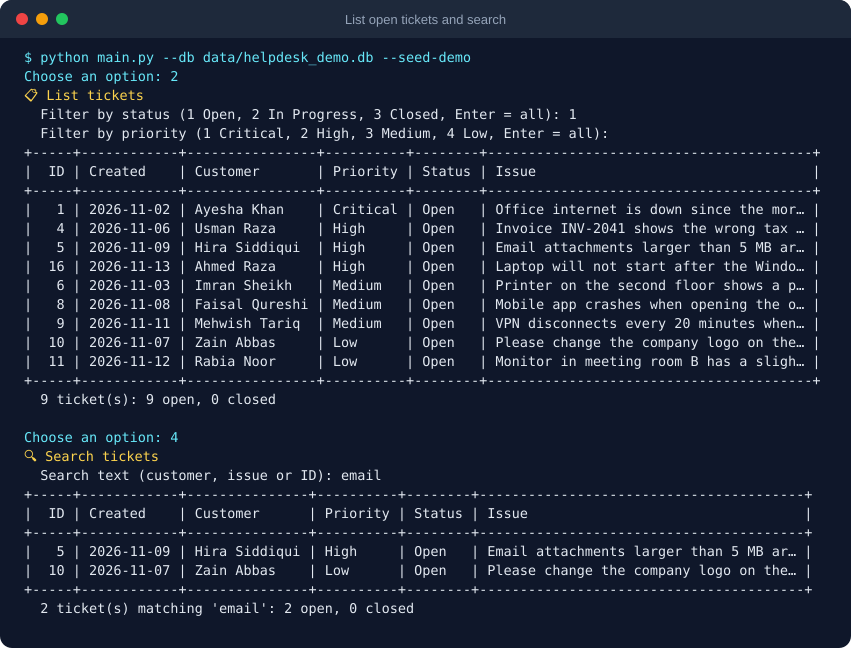
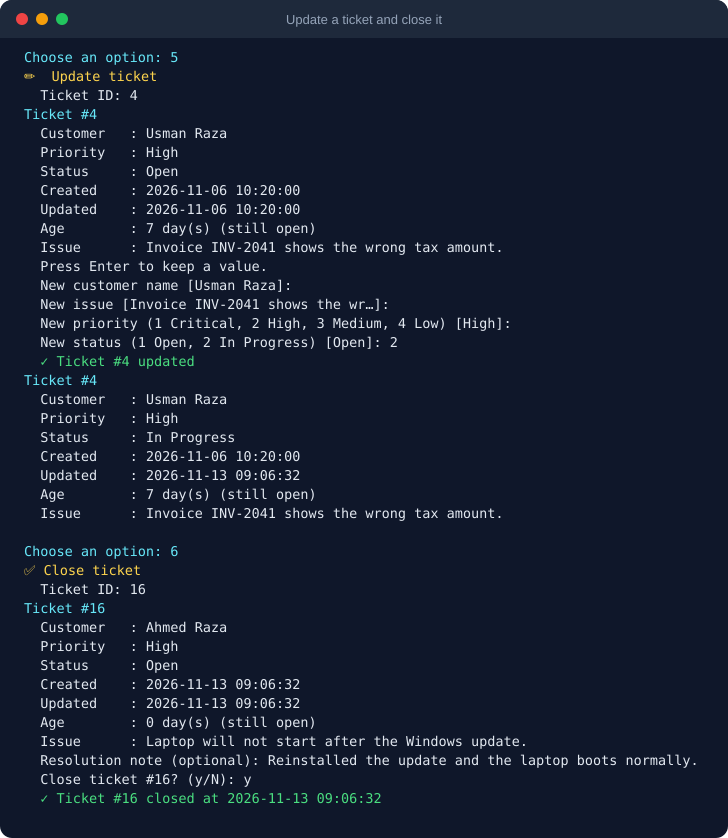
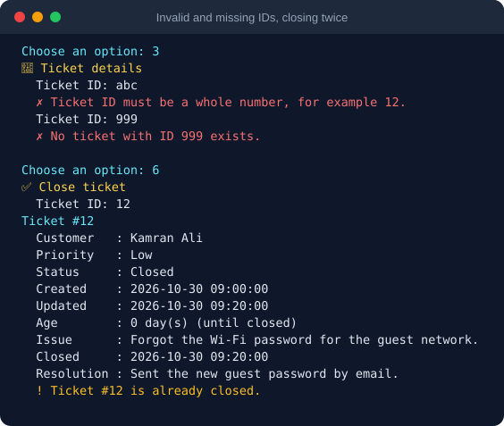
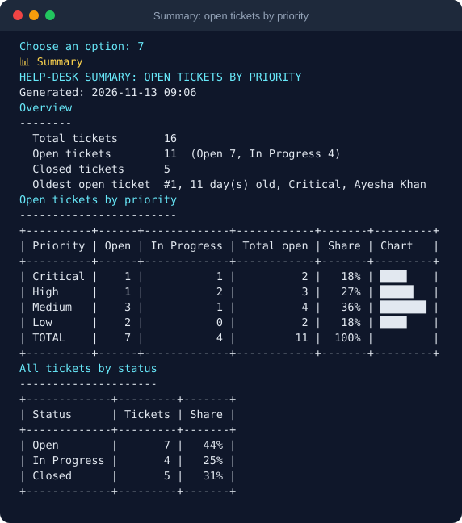
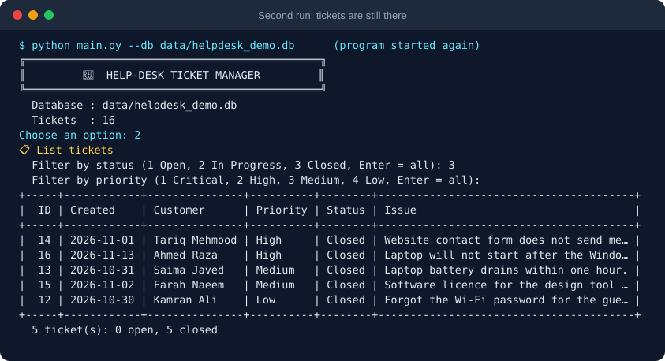
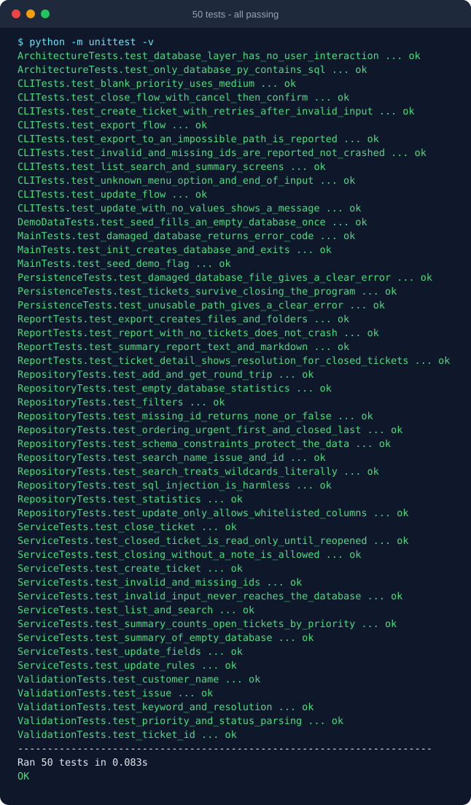

<p align="center">
  
</p>

<p align="center">
  
  
  
  
  
  
</p>

<h1 align="center"> Help-Desk Ticket Manager</h1>

<p align="center">
  A small, modular help-desk system for a fictional company. Tickets are saved in a local SQLite database,<br>
  so they are still there after the program closes.<br>
  <b>Python Programming - Advanced Level | Task 4</b>
</p>

---

## 📑 Table of Contents
1. [Overview](#-overview)
2. [Database Setup and Quick Start](#-database-setup-and-quick-start)
3. [Menu](#-menu)
4. [Data Model](#-data-model)
5. [Architecture](#-architecture)
6. [Validation and Error Handling](#%EF%B8%8F-validation-and-error-handling)
7. [Summary Report](#-summary-report)
8. [Screenshots and Terminal Output](#%EF%B8%8F-screenshots-and-terminal-output)
9. [Tests](#-tests)
10. [Project Structure](#-project-structure)
11. [Requirements Checklist](#-requirements-checklist)

---

## 🔭 Overview

| | |
|---|---|
| **Company** | NovaTech Solutions (fictional; all demo names and issues are invented) |
| **Purpose** | Record customer problems as tickets and follow them until they are solved |
| **Language and database** | Python 3.9+ and SQLite (built into Python, nothing to install) |
| **Design** | Object-oriented, five separate layers (see [Architecture](#-architecture)) |
| **Tests** | 50 unit tests |

| Feature | Details |
|---|---|
| ➕ **Create** | Customer name, issue, priority; creation date and status `Open` are set automatically |
| 📋 **View** | List all tickets, filter by status and priority, or open one ticket in full |
| 🔍 **Search** | By customer name, words in the issue, or ticket ID |
| ✏️ **Update** | Change name, issue, priority or status (`Open` / `In Progress`) |
| ✅ **Close** | Close a ticket with an optional resolution note; closed tickets can be reopened |
| 📊 **Summary** | Open tickets by priority, with counts, shares and a bar chart |
| 📤 **Export** | Save the summary as `.txt` or `.md` |

---

## 🚀 Database Setup and Quick Start

**Requirements:** Python 3.9 or newer. No packages to install (`sqlite3` is part of Python).

| Step | Command | What happens |
|:-:|---|---|
| 1 | `python main.py --init` | Creates `data/helpdesk.db` and the `tickets` table (from `helpdesk/schema.sql`), then exits |
| 2 | `python main.py --seed-demo` | *(optional)* Adds 15 demo tickets, but only if the database is empty |
| 3 | `python main.py` | Starts the menu |

> Step 1 is optional: the database and table are also created automatically the first time you start the program. Running the setup again is safe, because the schema uses `CREATE TABLE IF NOT EXISTS`.

| Task | How |
|---|---|
| Use another database file | `python main.py --db my_company.db` |
| Look inside the database | `sqlite3 data/helpdesk.db ".schema"` and `sqlite3 data/helpdesk.db "SELECT * FROM tickets;"` |
| Start again from zero | Close the program and delete the `.db` file |
| Run the tests | `python -m unittest -v` |

---

## 🧭 Menu

| Key | Action | Notes |
|:-:|---|---|
| `1` | Create ticket | Wrong answers are rejected and asked again; Enter on priority means *Medium* |
| `2` | List tickets | Optional filters; open tickets are listed first, most urgent on top |
| `3` | View ticket details | Shows every field, age in days and the resolution |
| `4` | Search tickets | Customer, issue text or ticket ID |
| `5` | Update ticket | Press Enter to keep a value |
| `6` | Close ticket | Optional resolution note and a confirmation question |
| `7` | Summary | Open tickets by priority |
| `8` | Export summary report | `.txt` or `.md` |
| `0` | Exit | Everything is already saved |

---

## 🗃️ Data Model

**Table `tickets`** (defined in [`helpdesk/schema.sql`](helpdesk/schema.sql))

| Column | Type | Rule |
|---|---|---|
| `id` | INTEGER, primary key | Assigned automatically (1, 2, 3...) |
| `customer_name` | TEXT | Required, 2 to 60 characters |
| `issue` | TEXT | Required, 5 to 500 characters |
| `priority` | TEXT | `Low`, `Medium`, `High` or `Critical` (default `Medium`) |
| `status` | TEXT | `Open`, `In Progress` or `Closed` (default `Open`) |
| `created_at` | TEXT | Creation date and time, `YYYY-MM-DD HH:MM:SS` |
| `updated_at` | TEXT | Time of the last change |
| `closed_at` | TEXT | Filled **only** when the status is `Closed` |
| `resolution` | TEXT | Optional note written when the ticket is closed |

The database itself refuses wrong data with `CHECK` constraints (invalid priority or status, text length, and `closed_at` filled only for closed tickets), and two indexes speed up the common searches.

**Status rules**

| From | To | How |
|---|---|---|
| Open | In Progress | Update ticket |
| In Progress | Open | Update ticket |
| Open or In Progress | Closed | **Close ticket** (not through Update, so a resolution can be recorded) |
| Closed | Open or In Progress | Update ticket (*reopen*; closing time and resolution are cleared) |
| Closed | anything else | **Not allowed.** A closed ticket is read-only until it is reopened. |

---

## 🧱 Architecture

<p align="center"></p>

The task asks to separate database operations from user interaction. Each layer has one job and only talks to the next one:

| File | Class or role | Contains | Must **not** contain |
|---|---|---|---|
| `helpdesk/cli.py` | `HelpDeskCLI` | Menus, questions, printing | SQL, business rules |
| `helpdesk/service.py` | `TicketService` | Rules, validation calls, "not found" errors, summary | SQL, `input()`, `print()` |
| `helpdesk/database.py` | `TicketRepository` | **All SQL**: insert, update, select, counts | `input()`, `print()`, business rules |
| `helpdesk/models.py` | `Ticket`, `Priority`, `Status`, `TicketSummary` | Plain data classes | Database or UI code |
| `helpdesk/validation.py` | functions | Input checks | Database or UI code |
| `helpdesk/reports.py` | functions | Tables, ticket details, summary text and export | Database access |
| `helpdesk/errors.py` | exceptions | `ValidationError`, `TicketNotFoundError`, `InvalidOperationError`, `DatabaseError` | |

A test (`ArchitectureTests`) reads the source files and fails if SQL appears outside `database.py` or if `database.py` uses `input()` or `print()`.

**Other design points**

* **Dependency injection:** `HelpDeskCLI` receives its input and output functions and the service receives a clock, so the whole program can be tested with scripted answers and a fixed time.
* **Safe SQL:** every query uses `?` placeholders. Column names in `UPDATE` come from a fixed whitelist. Search text is escaped so `%` and `_` are matched literally.
* **Safe saving:** every write runs in a transaction that is committed on success and rolled back on error.

---

## 🛡️ Validation and Error Handling

**Input validation**

| Input | Rule |
|---|---|
| Customer name | 2 to 60 characters; letters, spaces, `.`, `'` and `-` only; must start with a letter |
| Issue | 5 to 500 characters (extra spaces are cleaned) |
| Priority | Critical, High, Medium or Low (any letter case), or the numbers 1 to 4 in the menu |
| Status | Open or In Progress when updating (any letter case), or the numbers 1 and 2 |
| Ticket ID | Whole number, for example `12` or `#12`; `abc`, `-3`, `0`, `3.5` are rejected |
| Search text | 2 to 50 characters |
| Resolution | Optional, up to 300 characters |

**Problems and how they are handled**

| Problem | Result |
|---|---|
| Wrong format in a question (empty name, short issue, bad priority, ID `abc`) | Clear message and the same question is asked again |
| ID that does not exist (view, update, close) | `✗ No ticket with ID 999 exists.` and the menu returns |
| Closing a ticket that is already closed | Rejected with a message; nothing changes |
| Editing a closed ticket | Rejected until it is reopened |
| Update with no new values, or the same values | Rejected with a message |
| No tickets match a filter or search | `No tickets found...` message |
| Damaged or non-SQLite database file | `Cannot open the database: The file is not a valid SQLite database...` (exit code 1) |
| Database path that cannot be created | Clear error message instead of a crash |
| Report cannot be written (bad path) | Message; the program keeps running |
| Input ends or Ctrl+C | The program exits politely; saved data is safe |

---

## 📊 Summary Report

Menu option `7` (and the export in option `8`) shows **open tickets by priority**. "Open" means status `Open` or `In Progress`. The numbers below come from the real demo session.

| Priority | Open | In Progress | Total open | Share |
|:---|---:|---:|---:|---:|
| Critical | 1 | 1 | 2 | 18% |
| High | 1 | 2 | 3 | 27% |
| Medium | 3 | 1 | 4 | 36% |
| Low | 2 | 0 | 2 | 18% |
| **Total** | **7** | **4** | **11** | **100%** |

<p align="center"></p>

The report also shows the total number of tickets (16), closed tickets (5), the oldest open ticket (#1, Critical, 11 days old) and all tickets by status. Exported examples: [`summary_report.txt`](sample_output/summary_report.txt) and [`summary_report.md`](sample_output/summary_report.md).

---

## 🖼️ Screenshots and Terminal Output

All screenshots come from real runs of the program (demo data from `--seed-demo`). Full transcripts: [`demo_session.txt`](sample_output/demo_session.txt) and [`demo_persistence.txt`](sample_output/demo_persistence.txt).

**1. Creating a ticket (invalid answers are rejected and asked again)**



**2. Listing open tickets and searching**



**3. Updating a ticket and closing it**



**4. Invalid IDs, missing records and closing twice**



**5. Summary: open tickets by priority**



**6. Persistence: the program was started again and the tickets are still there**



---

## ✅ Tests

Run with `python -m unittest -v`. All 50 tests pass.



| Area | What is checked |
|---|---|
| Validation | Names, issues, priority and status parsing, many bad IDs |
| Database layer | Add and get, ordering, filters, search, wildcard escaping, **SQL injection**, column whitelist, schema `CHECK` rules, statistics |
| Persistence | Tickets survive closing and reopening the database; nested folders are created |
| Damaged files | Non-SQLite file and unusable path give a clear error |
| Service rules | Create, update, close, reopen, read-only closed tickets, invalid and missing IDs, summary |
| Reports | Text and Markdown summary, empty database, export |
| User interface | Scripted sessions: retries after bad input, missing IDs, update, close with cancel, search, export, end of input |
| Architecture | No SQL outside `database.py`; no `print()` or `input()` in the database layer |
| Entry point | `--init`, `--seed-demo`, damaged database returns exit code 1 |

---

## 📁 Project Structure

```
Task4_HelpDesk_Ticket_Manager/
├── main.py                     # entry point (--db, --init, --seed-demo)
├── README.md
├── helpdesk/
│   ├── schema.sql              # database setup
│   ├── database.py             # TicketRepository: all SQL
│   ├── service.py              # TicketService: business rules
│   ├── cli.py                  # HelpDeskCLI: menus and prompts
│   ├── models.py               # Ticket, Priority, Status, TicketSummary
│   ├── validation.py           # input checks
│   ├── reports.py              # tables and summary report
│   ├── errors.py               # custom exceptions
│   └── demo_data.py            # 15 fictional demo tickets
├── tests/
│   └── test_helpdesk.py        # 50 tests
├── assets/                     # banner, icon, diagram, chart, screenshots
└── sample_output/
    ├── demo_session.txt        # full interactive session
    ├── demo_persistence.txt    # second run: data is still there
    ├── summary_report.txt
    └── summary_report.md
```

---

## 🎯 Requirements Checklist

| Requirement | Status | Where |
|---|:-:|---|
| Tickets with customer name, issue, priority, creation date, status | ✅ | `tickets` table, `Ticket` class |
| SQLite so tickets remain after the program closes | ✅ | `database.py`; proof in screenshot 6 and `PersistenceTests` |
| Viewing, searching, updating and closing tickets | ✅ | Menu options 2 to 6 |
| Code organised in classes and functions; database separated from user interaction | ✅ | [Architecture](#-architecture), `ArchitectureTests` |
| Validate input; handle invalid IDs and missing records | ✅ | [Validation and Error Handling](#%EF%B8%8F-validation-and-error-handling) |
| Summary of open tickets by priority | ✅ | Menu option 7, [Summary Report](#-summary-report) |
| Source code, database setup instructions and README | ✅ | [Database Setup](#-database-setup-and-quick-start) |
| Screenshots or terminal output of ticket creation and reports | ✅ | [Screenshots](#%EF%B8%8F-screenshots-and-terminal-output), `sample_output/` |

---

<p align="center">Made with Python 🐍 and SQLite 🗃️ | Domain 3 - Task 4</p>
